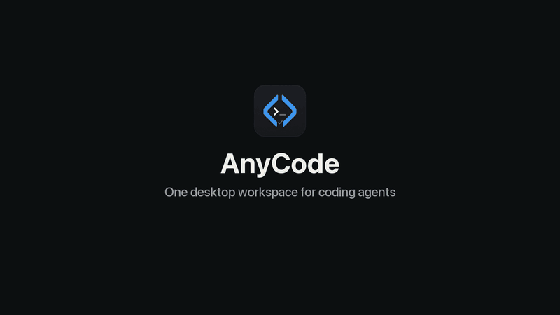

# AnyCode

  

**One desktop workspace over several AI coding agents.** Run a session on the
Claude Code CLI, on the Codex CLI, or on AnyCode's own multi-provider agent
loop — and get the same workspace either way: transcript, tool calls,
permission prompts, file actions, terminal, context usage, MCP servers, skills,
subagents, and Git review.

AnyCode is not another agent — it is the shell around the agents you already run.

**Bring your own agent.** A profile launches an agent CLI you already installed
and are entitled to use, under your own account and your own provider's terms.
AnyCode neither stores nor proxies its credentials — the process runs on your
machine.

**How it differs from other agent desktops** (Conductor, Superset, vendor
GUIs): one shell over *several* engines rather than one vendor's runtime;
subagents can run on a different engine than their parent session; the CLI
adapters are pinned against recorded protocol fixtures, so engine drift fails
the build instead of your session; and a sandboxed preview window the agent
drives itself (open a page, read its console, take a screenshot).

**Your keys stay yours.** Provider keys are encrypted through Electron's
`safeStorage` using OS-backed encryption and stored as ciphertext in
`~/.anycode/secrets.json`. If secure encryption is unavailable, saving a key
requires explicit consent to weaker storage (obfuscation or plaintext).
Decrypted keys are kept out of the renderer, and setup exports contain no keys.



## First run

The welcome screen offers one tile per way you already pay for a model:

- **ChatGPT / Codex**: sign in with your ChatGPT account; AnyCode can install
  and update the Codex CLI for you.
- **Claude Code**: use your Claude account through the official `claude` CLI
  (install it first).
- **Coding subscriptions**: **GLM Coding Plan**, **MiniMax M Plan**,
  **Kimi (kimi.com)** and **OpenCode Go**. Each tile opens the connection form
  with the provider preselected and a link to the page where you get the key:
  paste it and you land on the catalog's default model.
- **API key or local model**: Anthropic, OpenAI, OpenRouter, DeepSeek,
  Moonshot, Xiaomi MiMo, vLLM, or any OpenAI- or Anthropic-compatible endpoint.

Subscription connections show their remaining quota on the connection card:
the 5-hour and weekly windows for GLM Coding Plan and MiniMax M Plan, the
5-hour, weekly and monthly windows for OpenCode Go. Codex plan limits appear
separately in Settings → Codex.

## Engine profiles

| Profile | What runs the session | What it adds |
|---|---|---|
| **Claude Code** | The official Claude Code CLI, headless stream | Image attachments, reasoning effort (changeable mid-turn), context meter with a configurable window limit, `/compact`, browser tools, delegation to AnyCode agent profiles |
| **Codex** | The OpenAI Codex CLI over its `app-server` protocol | Several accounts with a default one, quotas and plan panel, Fast mode, reasoning effort, Orchestrate mode, session import, continue a conversation on another account, managed binary |
| **Native** | AnyCode's own agent loop | Anthropic, OpenAI, OpenRouter, Z.AI (GLM), DeepSeek, Moonshot and Kimi, MiniMax, Xiaomi MiMo, OpenCode Go, vLLM, and any OpenAI- or Anthropic-compatible endpoint, local ones included; per-step cost estimates, model switching between turns |

Capabilities follow the engine. Each profile exposes what its backend actually
supports, and an action the backend cannot perform is disabled rather than shown
as working.

Subagents are not bound to the engine running the session. An agent profile
can pin its children to the Codex or the Claude Code CLI, so a Native session
can hand a task to a different agent and receive the result in the same
transcript. A ready-made multi-model example — a GLM lead with an optional
inline Flash executor, verified by a GPT/Codex supervisor — is documented in
[Orchestration](docs/orchestration.md).

**Orchestrate mode** turns a tab into a read-only supervisor: `/orchestrate
<task>` plans the work and hands it to background child sessions in built-in
`planner`, `executor` and `reviewer` roles, whose reports arrive as new turns.
Settings → Roles decides which engine, connection, model and effort each child
role runs on, with ordered fallbacks when a quota or key fails. It works in Native
and Codex tabs; Claude Code Orchestrate is not available yet. See
[Orchestration](docs/user/orchestration.md).

What a session produces can be looked at without leaving the workspace. A local
markdown or HTML file opens in a preview — a panel beside the transcript or a
window of its own — and the agent can drive that preview itself: open a page,
read back its text and console, take a screenshot of it. Previews are sandboxed,
fetch nothing from the network on their own, and obey the same consent model as
every other file action.

Subagents can also run in the background. A detached child keeps working while
the parent session goes on, and the parent is told when something needs it:
the child is waiting for an approval (which tool, which path, and how long the
request stays open), it is close to its turn budget, it has gone quiet, or it
has finished. See [Subagents](docs/user/subagents.md) and
[Orchestration](docs/user/orchestration.md).

With a language server configured, the agent sees its diagnostics in the result
of every Edit or Write to a matching file, so a broken edit is visible in the
same step rather than at the next manual type check. Settings shows whether each
server is installed and running. See [Language servers](docs/user/lsp.md).

More in the box:

- **Sessions API**: a local, token-protected MCP endpoint that lets Claude
  Code, Codex or a script list your shared sessions, send them messages, wait
  for results, answer approvals, and open new tabs in projects you allow. See
  [Sessions API](docs/user/sessions-api.md).
- **Plugins**: install from a URL, file or folder,
  with consent for every MCP server and background service a plugin starts.
  The Telegram example plugin lets you drive your sessions from a private chat
  ([remote control](docs/user/remote-control.md)).
- **Vision fallback**: a model that cannot see images asks a second model you
  choose in Settings → Vision.
- **Costs and quotas**: per-step and per-session cost estimates from catalog or
  your own rates, cache savings, and subscription quota windows on connection
  cards.
- **Extensions menu** in each session header: see the MCP servers,
  skills, plugins and language servers that session uses, and toggle servers,
  skills and plugins.
- **Export / import setup**: move connections and role profiles to another
  machine as JSON, without any keys.

Both CLI profiles are pinned against recorded protocol fixtures: the adapters
have to stay in sync with the recorded streams, so a change on our side that
drops or invents a wire message fails the build rather than surfacing as a
broken session. Re-checking a pin against a freshly released CLI is a separate
opt-in run against the real binary, not part of the default suite.

## Status

AnyCode is in **alpha** (the current version is on the
[Releases](https://github.com/incadawr/anycode/releases) page). Storage, APIs,
and UI may change without backward-compatibility guarantees, and alpha builds
are unsigned — signing arrives with the beta.

How far validation has gone: the Codex and Claude Code profiles are covered by
recorded protocol fixtures and live smoke runs. Native has seen live use on
Z.AI (GLM), Kimi, DeepSeek, MiniMax and Xiaomi MiMo. Direct-API reasoning replay
measurements cover Z.AI, DeepSeek, MiniMax International and MiMo's SGP token
plan, with different evidence strength per endpoint
([table](docs/development/reasoning-history.md)). Other supported providers
have seen less live use; paid OpenCode Go Anthropic Messages and Responses
routes have been tested with fixtures only.

Right now the most valuable contribution is a bug report from real use: a
broken session, a workflow that doesn't fit, a provider that misbehaves —
[open an issue](https://github.com/incadawr/anycode/issues).

## Download

Installers are on the [Releases](https://github.com/incadawr/anycode/releases/latest) page:

| Platform | File |
|---|---|
| macOS, Apple silicon | `AnyCode-<version>-arm64.dmg` |
| macOS, Intel | `AnyCode-<version>.dmg` |
| Windows | `AnyCode-Setup-<version>.exe` |
| Linux | `AnyCode-<version>.AppImage` (make it executable first) |

Because alpha builds are unsigned, the first launch needs one confirmation:

- **Windows**: SmartScreen reports an unknown publisher; choose **More info → Run
  anyway**.
- **macOS**: the first launch is refused. Open **System Settings → Privacy &
  Security**, find AnyCode near the bottom, and press **Open Anyway**.

Updates: on Windows and Linux the app checks for a new version; you choose when to
download it and restart to install it, with download progress shown. On macOS
it tells you a new version is out and links to the Releases page, because
unsigned builds cannot update themselves.

Engines: the Codex CLI can be installed from Settings → Codex. For Claude Code
tabs, install the official `claude` CLI and sign in from Settings → Claude.

## Getting started from source

Requirements: Node.js 22 or newer and pnpm 10.

```bash
pnpm install --frozen-lockfile
pnpm --filter @anycode/desktop dev
```

Configure a provider in the application, or, for local development, supply
`ANYCODE_API_KEY`, `ANYCODE_MODEL`, and `ANYCODE_BASE_URL`.

## Verification

```bash
pnpm -w typecheck
pnpm test
pnpm --filter @anycode/desktop build
```

The development-only GUI automation boundary and smoke workflow are documented
in [Automation smoke](docs/development/automation-smoke.md). See the
[release policy](docs/development/release.md) for versioning and release
procedure, and [CHANGELOG.md](CHANGELOG.md) for user-facing changes.

## Repository layout

- `apps/desktop` — the Electron application.
- `apps/cli` — the command-line interface.
- `packages/core` — the agent loop and shared platform logic.
- `docs/user` — user-facing configuration and setup documentation (start at
  [docs/user/README.md](docs/user/README.md)).
- `docs/development` — public development, automation, and release guidance.

## Roadmap and contribution guidance

[ROADMAP.md](ROADMAP.md) describes the direction, and open
[issues](https://github.com/incadawr/anycode/issues) track concrete work.
Questions and ideas are welcome in
[Discussions](https://github.com/incadawr/anycode/discussions).

Contributions and feedback are welcome — please read
[CONTRIBUTING.md](CONTRIBUTING.md) before opening an issue or a pull request.
For security vulnerabilities, use the private reporting process in
[SECURITY.md](SECURITY.md).

## License

AnyCode is licensed under the [Apache License 2.0](LICENSE).

«AnyCode» and the AnyCode logo are trademarks of Evgenii Dubov. The Apache 2.0
license covers the code, not the name — forks must use a different name.
